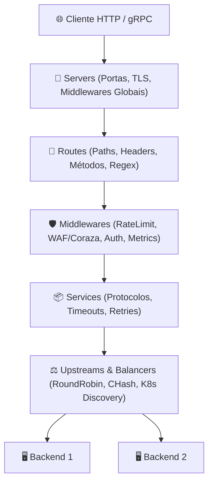

# 🌈 Bifrost: API Gateway Library em Go

O **Bifrost** (`github.com/nite-coder/bifrost`) é uma biblioteca/SDK em **Go** para construção de API Gateways de baixa latência e alto throughput, desenhado como uma alternativa moderna a servidores tradicionais (como Nginx, Envoy, Kong ou Krakend).

Diferente de gateways distribuídos como executáveis fechados ou caixas-pretas que dependem de linguagens de script externas (Lua, WASM) ou plugins dinâmicos (`.so`), o Bifrost foi concebido como uma **biblioteca em Go puro**. Isso permite que middlewares, regras de roteamento e balanceadores de carga sejam escritos diretamente na linguagem, com tipagem estática e compilação em um **único binário estático**.

---

## ⚡ 1. Arquitetura & Diferenciais



### Principais Características
1. **Core CloudWeGo (Hertz + Netpoll):** Desenvolvido sobre o framework [Hertz](https://www.cloudwego.io/docs/hertz/) e a biblioteca de rede assíncrona `netpoll`, minimizando alocações de memória e overhead do Garbage Collector sob altíssima concorrência.
2. **Modelo de Processo Master-Worker:** Suporte nativo a *Graceful Reload* em nível de milissegundos. Atualizações de rotas e configurações dinâmicas são aplicadas sem encerramento abrupto de conexões TCP ativas.
3. **Middlewares em Go Nativo:** Permite plugar lógica customizada utilizando a assinatura padrão do Hertz (`*app.RequestContext`), eliminando penalidades de runtime de FFI ou WASM.
4. **WAF Embutido com Coraza:** Integração nativa com o [Coraza WAF](https://coraza.io/), totalmente em Go e compatível com o **OWASP Core Rule Set (CRS v4)** e regras SecLang.
5. **Observabilidade Nativa:** Exportação nativa de métricas para [Prometheus](../observabilidade/prometheus.md) e rastreamento distribuído via [OpenTelemetry](../observabilidade/opentelemetry.md).

---

## 🏢 2. Componentes Estruturais da Configuração

A topologia do Bifrost é estruturada em 4 blocos principais no arquivo declarativo (`config.yaml`):

| Bloco | Responsabilidade | Recursos Principais |
| :--- | :--- | :--- |
| **`servers`** | Pontos de entrada e portas de escuta. | Endereço de bind, TLS, HTTP/1.1, HTTP/2, H2C, WebSocket e middlewares globais. |
| **`routes`** | Casamento de regras e encaminhamento. | Matchers por prefixo, exato, regex, headers, query params e middlewares de rota. |
| **`services`** | Definição da camada de serviço de destino. | Protocolo de transporte, reescrita de caminhos (`rewrite`), timeouts, retries e políticas de fallback. |
| **`upstreams`** | Gerenciamento de nós de backend. | Algoritmos de balanceamento (`round_robin`, `random`, `weighted`, `chash`), health checks e descoberta de serviços. |

### Provedores de Descoberta de Serviços (`providers`)
* **`k8s`:** Descoberta dinâmica de endpoints diretamente da API do Kubernetes via namespaces e labels.
* **`file`:** Leitura e recarga automática de arquivos de configuração (`watch: true`).
* **`dns`:** Resolução contínua de registros DNS com TTL configurável.
* **`nacos`:** Integração com central de configuração distribuída Nacos.

---

## 🧩 3. Extensibilidade Nativa & Compilação em Binário Único

Uma das maiores vantagens arquiteturais do Bifrost é a capacidade de compilar o gateway junto com todos os módulos e plugins proprietários em um **único executável estático**, evitando as fragilidades e complexidades de build de bibliotecas compartilhadas `.so` em Go (CGO).

### Pontos de Extensão no Código-Fonte

| Componente | Ponto de Registro | Assinatura / Interface |
| :--- | :--- | :--- |
| **Middlewares** | `pkg/middleware` | `middleware.Register[T any](names []string, handler func(T) (app.HandlerFunc, error))` |
| **Balanceadores** | `pkg/balancer` | `balancer.Register(names []string, h CreateBalancerHandler)` onde `Balancer.Select(ctx, hzCtx)` |
| **Lifecycle Hooks** | `bifrost` | `bifrost.WithInit(fn func(config.Options) error)` (executa após ler config e antes do tráfego) |
| **CLI Flags** | `bifrost` | `bifrost.WithFlags(flags ...cli.Flag)` (adiciona flags de linha de comando customizadas) |
| **Adaptadores IA (Ingress)** | `pkg/ai` | `ai.RegisterClientAdapter(name string, factory ClientAdapterFactory)` |
| **Adaptadores IA (Egress)**  | `pkg/ai` | `ai.RegisterLLMAdapter(name string, factory AdapterFactory)` (`LLMAdapter` interface) |
| **Modo Programático** | `pkg/gateway` | `gateway.Run(options)` ou `gateway.NewBifrost(options, gateway.ModeNormal)` |

---

### Padrão de Arquitetura: Blank Imports + `init()`

O padrão idiomático para compilar módulos customizados consiste em estruturar os plugins em subpacotes que se auto-registram via `init()` e importá-los via *blank import* no `main.go`:

```text
cmd/gateway/
├── main.go
└── plugins/
    ├── auth/          # middleware.Register("custom_auth", ...)
    └── customlb/      # balancer.Register("tenant_balancer", ...)
```

#### 1. Implementação do Middleware Customizado (`plugins/auth/auth.go`):
```go
package auth

import (
	"context"

	"github.com/cloudwego/hertz/pkg/app"
	"github.com/nite-coder/bifrost/pkg/middleware"
)

// Configuração mapeada automaticamente do bloco YAML 'params' via mapstructure
type Config struct {
	HeaderKey string `mapstructure:"header_key"`
}

func init() {
	_ = middleware.Register([]string{"custom_auth"}, func(cfg Config) (app.HandlerFunc, error) {
		return func(c context.Context, ctx *app.RequestContext) {
			token := ctx.Request.Header.Get(cfg.HeaderKey)
			if token == "" {
				ctx.AbortWithStatusJSON(401, map[string]string{"error": "unauthorized"})
				return
			}
			ctx.Set("auth_token", string(token))
			ctx.Next(c)
		}, nil
	})
}
```

#### 2. Entrypoint Unificado (`cmd/gateway/main.go`):
```go
package main

import (
	"log/slog"
	"os"

	"github.com/nite-coder/bifrost"
	"github.com/nite-coder/bifrost/pkg/config"
	"github.com/urfave/cli/v2"

	// Auto-registro dos plugins no init()
	_ "meu-gateway/cmd/gateway/plugins/auth"
	_ "meu-gateway/cmd/gateway/plugins/customlb"
)

func main() {
	err := bifrost.Run(
		bifrost.WithVersion("1.0.0"),
		bifrost.WithFlags(
			&cli.StringFlag{
				Name:    "env",
				Usage:   "Ambiente de execução (staging, production)",
				EnvVars: []string{"APP_ENV"},
			},
		),
		bifrost.WithInit(func(opts config.Options) error {
			slog.Info("Inicializando conexões de banco e caches antes do tráfego...")
			return nil
		}),
	)

	if err != nil {
		slog.Error("falha ao executar gateway", "err", err)
		os.Exit(1)
	}
}
```

---

## ⚙️ 4. Exemplo de Configuração Declarativa (`config.yaml`)

```yaml
watch: true

servers:
  http_gateway:
    bind: "0.0.0.0:8080"
    middlewares:
      - type: cors
        params:
          allow_origins: ["*"]
          allow_methods: ["GET", "POST", "PUT", "DELETE", "OPTIONS"]

routes:
  api_routes:
    paths:
      - /api/v1/*
    service_id: backend_service
    middlewares:
      - type: custom_auth
        params:
          header_key: "X-API-Key"
      - type: ratelimit
        params:
          rate: 100
          burst: 200
          key_type: ip
      - type: coraza
        params:
          rules:
            - "Include @owasp_crs/REQUEST-911-METHOD-ENFORCEMENT.conf"

services:
  backend_service:
    url: "http://backend_upstream"
    timeout: 3000ms
    retries: 2

upstreams:
  backend_upstream:
    balancer: round_robin
    targets:
      - target: "10.0.1.10:8000"
        weight: 100
      - target: "10.0.1.11:8000"
        weight: 100
```

---

## 🔗 Referências & Leituras Relacionadas
* [Repositório Oficial no GitHub](https://github.com/nite-coder/bifrost)
* [Documentação do Framework Hertz](https://www.cloudwego.io/docs/hertz/)
* [Golang Core](golang.md)
* [Padrão Functional Options em Go](functional-options.md)
* [OpenTelemetry Tracing](../observabilidade/opentelemetry.md)
* [Prometheus Metrics](../observabilidade/prometheus.md)
