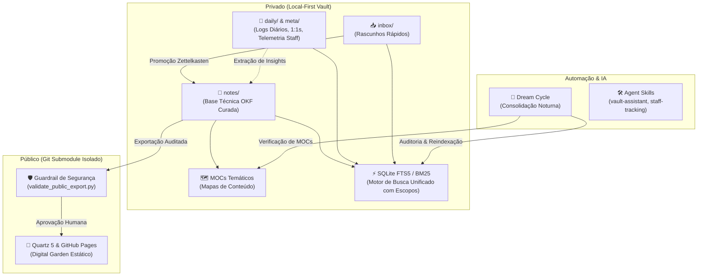

# 🧠 Como Construir um Second Brain Moderno com IA, Zettelkasten e Agentes Autônomos

Em um cenário de engenharia de software onde a velocidade de geração de código e tomada de decisão é multiplicada por Inteligências Artificiais, a memória humana e a documentação fragmentada tornam-se o principal gargalo.

Este artigo descreve a arquitetura, as diretrizes de governança e os componentes técnicos que desenvolvemos para criar um **Second Brain de alta performance**, projetado para ser operado por um **Staff Engineer em conjunto com Agentes de IA**.

---

## 🏛️ 1. Visão Geral da Arquitetura

O sistema baseia-se em cinco princípios fundamentais:
1. **Local-First & Plain Markdown (OKF):** Todos os arquivos residem no disco local em Markdown padrão com YAML frontmatter, sem dependência de bancos proprietários.
2. **Firewall de Publicação em Camadas:** Isolamento físico entre logs corporativos privados, notas técnicas curadas e o jardim digital público via Git Submodules.
3. **Motor de Busca Híbrido Unificado (SQLite FTS5 + BM25):** Indexação sub-milissegundo de todo o acervo (técnico, diários, pessoas e carreira) com escopos de relevância.
4. **Rotina Noturna Autônoma (*Dream Cycle*):** Rotina inspirada no padrão GBrain para consolidação diária, auditoria de links e alinhamento de Mapas de Conteúdo (MOCs).
5. **Publicação Contínua (Quartz 5 + GitHub Pages):** Pipeline que higieniza e publica notas selecionadas no GitHub Pages com busca instantânea e grafo de navegação.



---

## 📁 2. Topologia do Repositório e Formato OKF

Para que tanto humanos quanto LLMs naveguem com consistência determinística, o repositório segue uma topologia em minúsculas com nomenclatura em `kebab-case`:

```text
/ (raiz)
├── daily/       # Logs diários temporais e telemetria (Privado - Indexado Localmente)
├── inbox/       # Rascunhos rápidos aguardando promoção Zettelkasten
├── notes/       # Base curada de conhecimento técnico em OKF (Alvo Principal)
│   ├── arquitetura/     # C4, DDD, Hexagonal, Microservices, Resiliência
│   ├── dados/           # Elasticsearch, CDC, Apache Beam, Protobuf
│   ├── engenharia/      # Clean Code, SOLID, Design Patterns, Memory
│   ├── ferramentas/     # Neovim, Tmux, Git, CLI Tools, Hyperfine
│   ├── go/              # Runtime, Arenas, Struct Padding, Profiling
│   ├── ia/              # Agentes, MCP, RAG, SPDD, Engenharia de Prompts
│   ├── infra/           # Kubernetes, KEDA, Docker, Linux, SystemD
│   ├── linguagens/      # Rust, Lua, Haskell, Scala, Clojure, Bash
│   ├── observabilidade/ # OpenTelemetry, Prometheus, Tracing, DORA Metrics
│   └── moc-indice-geral.md # MOC Mestre e ponto de entrada da navegação
├── meta/        # Governança, ADRs, metas de carreira e pessoas (Privado)
└── public/      # Submódulo Git isolado conectado ao repositório público
```

### O Padrão OKF (Open Knowledge Format)
Toda nota permanente contém um cabeçalho YAML frontmatter padronizado:

```yaml
---
title: "Título Canônico da Nota"
type: tecnologia # tecnologia | arquitetura | processo | carreira
description: "Descrição concisa de uma a duas frases para SEO, popovers e indexação vetorial."
tags:
  - notes/ia
  - notes/arquitetura
---
```

---

## 🛡️ 3. O Firewall de Privacidade e Links Relativos

Uma dúvida clássica ao arquitetar um Second Brain é: *como balancear a capacidade de consulta da IA com a privacidade corporativa?*

Adotamos um modelo de **privacidade em duas frentes**:

### A. Indexação Local Unificada (Sem Nuvem)
Como o motor de busca SQLite FTS5 roda **exclusivamente na máquina local** (`.agents/cache/vault_index.db`), indexamos não apenas as notas técnicas, mas também os diários (`daily/`), perfis de pessoas e metas de carreira (`meta/`). Isso permite que o assistente responda:
- *"O que foi alinhado na última 1:1 com a liderança técnica?"*
- *"Em quais dias trabalhei na migração do proxy de borda?"*

Para evitar que anotações temporais poluam buscas conceituais de engenharia, o motor organiza o índice em **Escopos de Relevância**:
- `tech`: Busca focada na base técnica curada (`notes/`).
- `daily`: Linha do tempo e registros diários de bordo.
- `meta`: Perfis de pessoas, avaliações (AVDs), PDIs e ADRs.
- `all`: Busca global ponderada (prioriza notas conceituais).

### B. Isolamento Físico de Publicação (Git Submodule)
Para compartilhar conhecimento público sem risco de vazamento:
1. O diretório `public/` é um **submódulo Git independente**.
2. **Guardrail de Aprovação Humana Explícita:** Nenhum commit ou push em `public/` ocorre sem validação explícita do usuário.
3. O script `validate_public_export.py` audita automaticamente cada arquivo contra tokens JWT, credenciais, links quebrados ou menções a projetos internos antes da publicação.

---

## ⚡ 4. Motor de Busca Semântica e Híbrida Local

Em vez de depender de bancos vetoriais em nuvem com alta latência e custo, desenvolvemos um motor de busca local utilizando **SQLite FTS5 + BM25**:

- **Velocidade:** Indexa centenas de documentos em menos de **40 milissegundos**.
- **Ranking Ponderado:** Dá maior relevância para correspondências no título e no campo `description` do que no corpo do texto.
- **Grafo de Backlinks e Briefings Inteligentes:** Cruza perfis de pessoas com registros diários de 1:1s e reuniões em tempo real.

```bash
# Busca técnica com ranking BM25
python3 .agents/scripts/vault_search.py --tech "garbage collector arenas"

# Briefing completo de contexto e linha do tempo de 1:1s
python3 .agents/scripts/vault_search.py --person "Nome do Colega ou Tech Lead"

# Busca focada em tarefas diárias
python3 .agents/scripts/vault_search.py --daily "RFC"
```

---

## 🌙 5. O Dream Cycle: Manutenção Autônoma Noturna

Inspirado nas pesquisas de consolidação de memória do padrão **GBrain**, implementamos a rotina do **Dream Cycle** (`dream_cycle.py`). Ao final de cada dia de trabalho, o agente de IA executa esta rotina para manter a base saudável:

1. **Validação do Diário:** Audita as horas registradas no diário de bordo e calcula a distribuição de carga nas métricas de liderança técnica.
2. **Inspeção do Inbox:** Detecta rascunhos rápidos acumulados aguardando estruturação Zettelkasten.
3. **Sincronização de MOCs (Mapas de Conteúdo):** Garante que nenhuma nota técnica criada durante o dia fique órfã, inserindo-a automaticamente no MOC temático da categoria.
4. **Auditoria de Links e OKF:** Valida se 100% dos links relativos estão intactos e se os metadados frontmatter estão válidos.
5. **Reindexação do Motor de Busca:** Atualiza a tabela virtual FTS5 com todo o conteúdo gerado no dia.

---

## 🌿 6. Publicação Contínua com Quartz 5

Para compartilhar conhecimento com a comunidade sem expor dados internos:

1. As notas técnicas curadas são validadas pelo guardrail e exportadas para `public/content/`.
2. O **Quartz 5** processa a árvore Markdown, gerando uma Single Page Application (SPA) estática com:
   - Alternância de tema Dark/Light.
   - Busca instantânea no cliente (`Ctrl+K`).
   - Grafo interativo 2D de conexões conceituais.
   - Popovers de pré-visualização ao passar o mouse sobre os links.
3. O workflow do **GitHub Actions** compila e publica as atualizações automaticamente no **GitHub Pages**.

---

## 🎯 Conclusão

Construir um Second Brain projetado desde o primeiro dia para interoperar com Agentes de IA transforma o repositório de notas de um "cemitério de rascunhos" em um **parceiro ativo de engenharia**.

Com arquivos locais abertos, busca unificada sub-milissegundo com escopos inteligentes, firewall de publicação e rotinas autônomas de consolidação, você multiplica sua capacidade analítica, preserva o foco em problemas de alto impacto e mantém seu conhecimento técnico sempre vivo e acessível.
